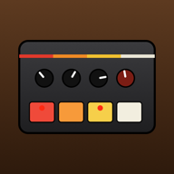

# Techno Workstation 🎛️

Eine komplette Techno-Groovebox im Browser – ohne Installation, ohne Server, ohne Abhängigkeiten.
Alle Geräte stehen auf einem Holztisch, laufen an **einer gemeinsamen Clock** und treffen sich in einem Live-Mixer mit Mastering-Kette.



## Geräte

| Gerät | Inspiriert von | Was es kann |
|---|---|---|
| **RC-08** Rhythm Composer | 808 | Instrument wählen → Steps tippen, Level/Tune/Decay/Tone pro Instrument, Accent-Spur |
| **RC-07** Digital Rhythm | 707 | LCD-Raster direkt bemalen, Level-Slider pro Instrument, „Grit“ für Sample-Charakter |
| **AB-03** Acid Bassline | 303 | Note, Oktave, Accent, Slide pro Step; Cutoff, Reso, Env Mod, Decay, Drive |
| **SK-01** Kick · Rumble · Sub | – | Techno-Kick mit Rumble-Hall und Sub-Bass, Sidechain eingebaut |
| **LX-1** Lead | – | Step-Lead-Synth mit Presets und Tie (Legato-Glide) |
| **CH-5** Chord Machine | – | Würfelt Akkordfolgen passend zu Tonart & Mood (Dreiklänge, sus, 7er, 9er, 11er, add9, gemischt) |
| **MX-24** Mixer | – | Drive, Comp, EQ, Crush, DJ-Filter, Sends (Room/Hall/Delay), Mute/Solo, Master mit Glue, Tape, Limiter, Pump |
| **FX-9** | – | Step-FX-Pinsel (Ratchet, Hall-/Delay-Throw, Crush, Filter, Oktave), Bus-Einstellungen, Live-Pads |
| **SQ-16** Arranger | – | Sektionen (Verse, Chorus, Drop …) als Szenen, Song-Kette |

**Global:** Tonart, BPM (inkl. Tap), Swing und 8 Moods von *Fröhlich* bis *Hölle*. Jeder Mood hat seine eigene Tonleiter, Akkordfärbung und Klangfarbe.
Jeder Sequenzer hat **4 Parts** mit **16 – 64 Steps** und eine programmierbare **Part-Kette** (z. B. `3x1 3 2x1 4`).

## Bedienung

- **Leertaste** – Play/Stop
- **Tasten 1–8** – Live-Pads halten (Wash, Echo, Roll ¼ / ⅛ / 1/16 / 1/32, Riser, Kill Low)
- Knöpfe: ziehen (Shift = fein), Mausrad, Doppelklick = Reset
- Steps: klicken oder über mehrere Steps malen
- Noten: Klick = an/aus, nach oben/unten ziehen = Tonhöhe (immer in der Tonart)
- Part-Button: Klick = bearbeiten & am Pattern-Ende spielen, Shift-Klick = nur bearbeiten
- Alles wird automatisch im Browser gespeichert (`localStorage`). Mit **Export/Import** sicherst du Sessions als JSON-Datei.

## Online stellen mit GitHub Pages

1. Neues Repository auf GitHub anlegen (z. B. `techno-workstation`).
2. Diesen Ordner hochladen:
   ```bash
   git remote add origin https://github.com/DEIN-NAME/techno-workstation.git
   git push -u origin main
   ```
3. Auf GitHub: **Settings → Pages → Build and deployment → Source: „Deploy from a branch“**, Branch `main`, Ordner `/ (root)` → **Save**.
4. Nach ca. einer Minute läuft die App unter `https://DEIN-NAME.github.io/techno-workstation/`.

### Als App installieren

Die Workstation ist eine **Progressive Web App** und funktioniert nach dem ersten Laden auch **offline**.

- **Chrome / Edge (Desktop):** Install-Symbol rechts in der Adressleiste
- **iPhone / iPad (Safari):** Teilen → „Zum Home-Bildschirm“
- **Android (Chrome):** Menü → „App installieren“

> Tipp iPhone: Ist der Stummschalter an, bleibt Web-Audio stumm.

### Lokal starten

Doppelklick auf `index.html` reicht. Für Offline-Modus/Installation braucht es einen Webserver, z. B.:

```bash
python3 -m http.server 8000
```

und dann `http://localhost:8000` öffnen.

## Updates veröffentlichen

Dateien ändern, committen, pushen – GitHub Pages aktualisiert sich automatisch.
Damit installierte Apps die neue Version sicher bekommen, in `sw.js` die Zeile `const VERSION = 'tws-v1'` hochzählen (`tws-v2` …).

## Technik

Reines HTML/CSS/JavaScript mit der Web Audio API – keine Bibliotheken, kein Build-Schritt.

| Datei | Inhalt |
|---|---|
| `index.html` | Grundgerüst |
| `style.css` | Tisch- und Geräte-Design |
| `data.js` | Musiktheorie, Moods, Akkord-Generator, Demo-Song |
| `engine.js` | Klangerzeugung, Mixer, Effekte, Mastering, Clock |
| `ui.js` | Oberfläche |
| `sw.js`, `manifest.webmanifest` | Offline & Installation |
